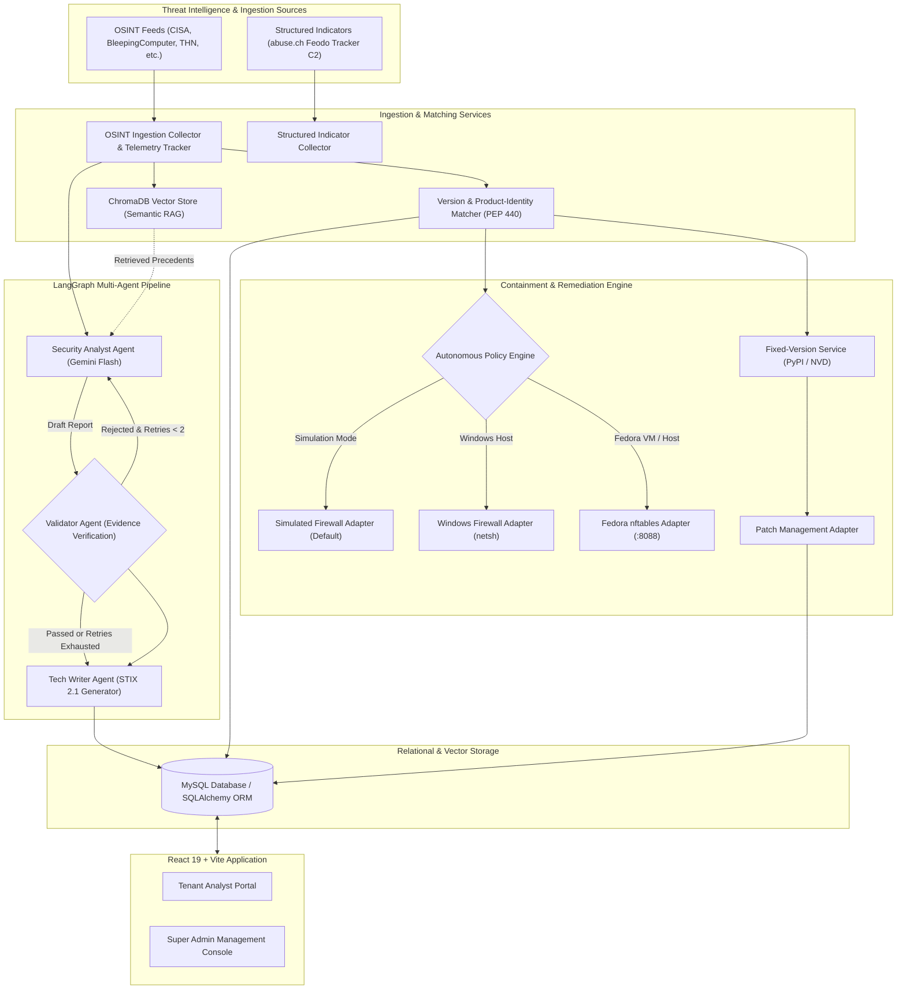
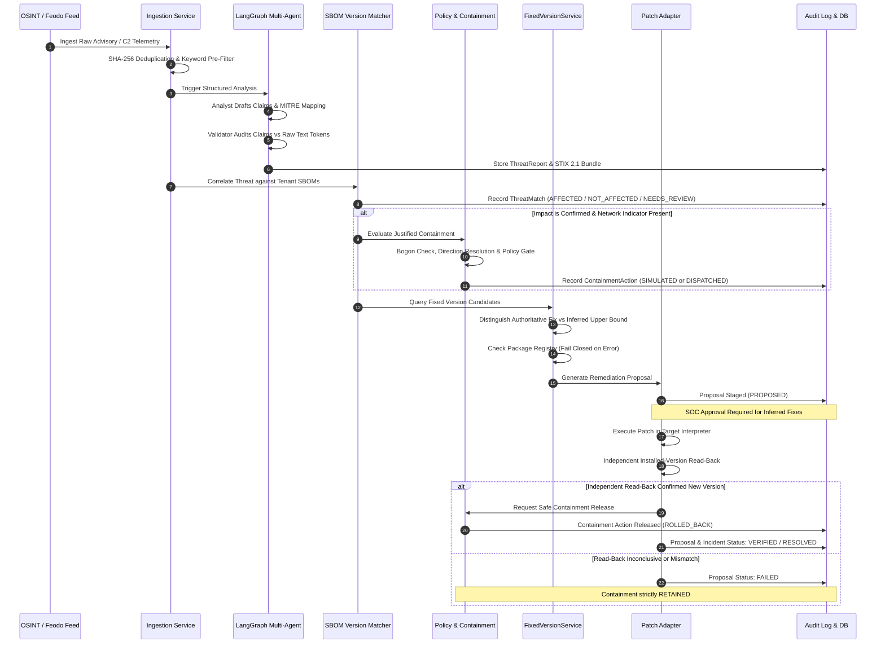

# CyberScribe — Autonomous Multi-Agent Cyber Threat Intelligence & Containment Platform

> **Autonomous Multi-Agent Cyber Threat Intelligence, Evidence Grounding, Vulnerability Correlation, and Policy-Governed Remediation Platform**

---

## 1. Project Overview

### Problem Statement
Modern Security Operations Centers (SOCs) face an overwhelming volume of cyber threat advisories, vulnerability disclosures, and botnet telemetry daily. SOC analysts encounter severe bottlenecks:
1. **Information Overload & Unstructured Noise:** OSINT advisories arrive in fragmented RSS/Atom feeds, unstructured HTML articles, and technical blogs lacking standardized schemas.
2. **Hallucination & Speculative Claims in LLM Tools:** Directly applying unconstrained generative Large Language Models (LLMs) to threat disclosures frequently introduces fabricated CVE identifiers, hallucinated MITRE ATT&CK techniques, and unsupported severity ratings.
3. **Product-Identity & Software-Component Mismatches:** Naive string matching triggers false-positive alarms when an advisory targets a derivative package or plugin (e.g., flagging core `SQLAlchemy` when an advisory specifically impacts `SQLAlchemyDA` for Zope).
4. **Disconnected & Risky Containment Automation:** Automated security tools either execute unverified firewall rules directly onto production perimeters or produce non-auditable actions without independent read-back verification, tenant isolation, or rollback capabilities.
5. **Premature Resolution Gaps:** Simulated patch operations or registry checks are frequently conflated with verified installations, prematurely clearing incident flags or releasing active containment without independent proof.

### Objectives & Mission
CyberScribe bridges the operational gap between threat discovery and incident response by:
- Ingesting, parsing, deduplicating, and tracking telemetry across public security advisories and high-confidence network indicator feeds.
- Embedding generative LLMs within a **bounded validation feedback loop** ($N \le 2$ retries) with deterministic verification safeguards.
- Normalizing findings to international standards (**OASIS STIX 2.1** JSON and **MITRE ATT&CK Enterprise Matrix**).
- Correlating disclosures against monitored tenant Software Bills of Materials (**SBOM**) using formal PEP 440 version range algebra.
- Orchestrating policy-governed containment across both **Windows Defender Firewall** and **Fedora Linux `nftables`** executors with mandatory independent read-back verification, TTL expiration, and exact-handle rollback.
- Discovering authoritative fixed versions, validating registry availability without false assumptions, executing patches in dedicated target environments, and releasing containment only upon verified remediation.

### Implementation Scope Summary
| Feature / Subsystem | Implementation Status | Verification Level | Technical Reality |
| :--- | :--- | :--- | :--- |
| **Continuous OSINT Ingestion** | Fully Implemented | Verified | 6 feeds active with keyword pre-filtering, SHA-256 deduplication, and thread mutex. |
| **Structured Indicator Collector** | Fully Implemented | Verified | abuse.ch Feodo Tracker C2 collector with deterministic confidence scoring (zero LLM in path). |
| **LangGraph Multi-Agent Pipeline** | Fully Implemented | Verified | Analyst, Validator, and Tech Writer agents with bounded feedback loop ($N \le 2$). |
| **Product-Identity Safeguards** | Fully Implemented | Verified | Rule engine prevents false matches on derivative software (e.g. `SQLAlchemyDA`, `ReactOS`). |
| **RAG & Vector Retrieval** | Fully Implemented | Verified | ChromaDB persistent vector store with sanitized metadata and cosine similarity retrieval. |
| **STIX 2.1 & MITRE ATT&CK** | Fully Implemented | Verified | Valid STIX 2.1 JSON bundles generated; MITRE techniques validated against cached taxonomy. |
| **Tenant SBOM Ingestion** | Fully Implemented | Verified | CycloneDX JSON, custom manifests, and CSV SBOM uploads parsed and linked to assets. |
| **Simulated Containment Adapter** | Fully Implemented | Verified | Default safe mode; records auditable actions, SOAR dispatches, and mock executions. |
| **Windows Firewall Adapter** | Fully Implemented | Verified | PowerShell `netsh advfirewall` execution with traffic direction resolution and rollback. |
| **Fedora `nftables` Executor** | Fully Implemented | Verified (Local Daemon) | Isolated microservice (:8088), restricted root helper, table priority -5; 45 subtests passed. |
| **Fixed-Version Safety Gates** | Fully Implemented | Verified | Registry errors fail closed; non-Python PyPI queries blocked; `< X` inferred fixes isolated. |
### Operational Fidelity: Live vs. Simulated vs. Synthetic Fixtures

To ensure scientific and engineering integrity during demonstrations and evaluation, CyberScribe explicitly distinguishes between three tiers of execution:

1. **Live Lab-Verified Operations:**
   - **Windows Defender Firewall Containment & Rollback:** Real inbound TCP rule enforcement (`CyberScribe_<ActionID>`) via an elevated daemon on port `8089`, validated live between a Windows host (`192.168.56.1`) and an authorized Fedora VM (`192.168.56.101`) over port 8000. Verified initial connectivity, live packet drop (connection timeout), exact rule rollback, and restored HTTP connectivity.
   - **Controlled Target Host Patching:** Live package updates executed strictly against a dedicated target interpreter virtualenv (e.g., Campus Guide's virtualenv) with independent post-execution readback (`pip show <package>`). Never executed inside CyberScribe's own host virtual environment.
   - **SOAR Webhook Integration:** Live HTTP POST delivery of structured remediation playbooks to tenant receiver endpoints (e.g. `POST /api/security/soar-webhook`), verified via receipt ledger confirmation and status tracking.

2. **Simulated Operations (Default Safety Mode):**
   - For safe day-to-day evaluation and automated testing, CyberScribe defaults to simulation mode (`CONTAINMENT_ADAPTER_MODE="simulated"`). In this mode, deterministic policy checks, bogon filters, and audit records are generated without modifying the host firewall or host system packages.

3. **Synthetic Demo Fixtures vs. Real Disclosures:**
   - Real-world OSINT is continuously ingested from live public feeds (CISA advisories, BleepingComputer, The Hacker News, abuse.ch Feodo Tracker C2).
   - In addition, specific demonstration records (e.g. `CVE-2026-AUTO`, `CVE-2026-8000`, `demo-live-cve-2026-8000`) serve as **synthetic demo fixtures** designed to deterministically demonstrate version range matching, direction gating, and remediation without waiting for arbitrary external CVE events. These synthetic fixtures are simulated test data and must not be described or interpreted as real-world public CVE disclosures.

---

## 2. Architecture and Workflow

### System Architecture


### End-to-End Operational Lifecycle


### Safety Gates & Failure Boundaries
1. **Registry Fail-Closed Boundary:** Network timeouts, HTTP 5xx, or malformed responses from PyPI or advisory registries never return `True` for package availability. Registry availability confirms release existence only; it is never treated as proof of vulnerability resolution.
2. **Ecosystem Isolation Boundary:** PyPI queries are strictly gated to the Python package ecosystem. Non-Python packages (RPM, Debian, npm, Maven) are never checked against PyPI.
3. **Inferred Fix Quarantine:** Heuristic upper-bound constraints (e.g. `< 2.0.44` suggesting `2.0.44`) are tagged `INFERRED_UPPER_BOUND` and strictly quarantined from automated live execution. Only vendor-confirmed authoritative fixes can be automatically deployed under `AUTOMATIC` policy.
4. **Simulation / Live Separation:** Simulated patch operations or mock containment releases never modify the recorded installed version, resolve incident records, or release live firewall rules.
5. **Containment Direction Gating:** Inbound versus outbound network traffic direction must be definitively resolved. Ambiguous or unestablished traffic direction is rejected with HTTP 400 and requires SOC approval.
6. **Bogon & Infrastructure Shield:** Private (RFC 1918), loopback (127.0.0.0/8), documentation (RFC 5737), carrier-grade NAT (RFC 6598), multicast, broadcast, and core DNS infrastructure (e.g., `8.8.8.8`, `1.1.1.1`) are permanently blocked from firewall containment rules.

---

## 3. Technology Stack & Repository Structure

### Technology Stack
- **Backend Core:** Python 3.12 / 3.13, FastAPI `>=0.110.0`, Uvicorn `0.28.0`, Pydantic v2 (`pydantic>=2.6.0`, `pydantic-settings>=2.2.0`).
- **Version Algebra:** `packaging>=23.0` (PEP 440 version specifications and specifier sets).
- **Multi-Agent Orchestration:** LangGraph `>=0.0.26` (StateGraph, conditional edges, cycle control), LangChain Core (`langchain>=0.1.10`), Google Gemini (`gemini-2.5-flash-lite` / `gemini-1.5-flash`).
- **Database & Storage:** SQLAlchemy 2.0 (`sqlalchemy>=2.0.25`), PyMySQL `1.1.0` (MySQL 8.0+), ChromaDB `0.4.24` (vector embeddings).
- **Security & Cryptography:** `python-jose[cryptography]>=3.3.0` (JWT), `passlib[bcrypt]>=1.7.4`, `bcrypt>=4.1.0`, `cryptography>=42.0.0` (AES-256 asset encryption).
- **Firewall & OS Executors:** Windows Defender Firewall (`netsh advfirewall`), Fedora Linux `nftables` via Python `subprocess` (shell=False, tokenized arguments).
- **Standards & Formats:** OASIS STIX 2.1, MITRE ATT&CK Enterprise Matrix (cached taxonomy), CycloneDX SBOM.
- **Frontend App:** React 19 (`react>=19.2.8`), Vite 6/8, Tailwind CSS v4, Lucide React, Axios.

### Directory Organization & Key Module Responsibilities
```
cyber_threat_agent_project/
├── README.md                                    # Comprehensive system documentation
├── .gitignore                                   # Ignore rules for caches, venv, and build artifacts
├── backend/                                     # FastAPI Python Backend
│   ├── .env.example                             # Environment configuration template
│   ├── main.py                                  # FastAPI application initialization & lifespan
│   ├── pytest.ini                               # Explicit test path & pattern configuration
│   ├── requirements.txt                         # Backend dependencies
│   ├── seed_admin.py                            # Super admin user seeding script
│   ├── backfill.py                              # Historical ChromaDB indexing script
│   ├── app/
│   │   ├── api/                                 # REST API endpoint route controllers
│   │   │   ├── admin.py                         # Super admin management endpoints
│   │   │   ├── auth.py                          # User & admin JWT authentication
│   │   │   ├── deps.py                          # Dependency injection & auth context
│   │   │   ├── logs.py                          # Telemetry & audit log endpoints
│   │   │   ├── tenants.py                       # Tenant profiles, SBOM, remediation & containment
│   │   │   └── threats.py                       # Threat intelligence & OSINT routes
│   │   ├── agents/                              # LangGraph multi-agent pipeline
│   │   │   ├── analyst.py                       # Security Analyst Agent (Drafting & extraction)
│   │   │   ├── validator.py                     # Validator Agent (Adversarial evidence checks)
│   │   │   ├── reporter.py                      # Tech Writer Agent (STIX 2.1 serialization)
│   │   │   ├── mitigation.py                    # Mitigation Agent (SOAR playbooks)
│   │   │   └── orchestrator.py                  # LangGraph StateGraph & feedback loop
│   │   ├── core/                                # System configuration & DB sessions
│   │   │   ├── config.py                        # Pydantic settings & environment validation
│   │   │   ├── database.py                      # SQLAlchemy engine & session factory
│   │   │   ├── chroma.py                        # ChromaDB client initialization
│   │   │   ├── llm.py                           # Robust Gemini LLM factory
│   │   │   └── security.py                      # Password hashing, JWT token creation
│   │   ├── models.py                            # SQLAlchemy relational database models
│   │   ├── schemas/                             # Pydantic DTO request/response schemas
│   │   └── services/                            # Business logic & threat engines
│   │       ├── containment_policy.py            # Deterministic policy engine & IP validation
│   │       ├── firewall_adapter.py              # Simulated firewall adapter & factory
│   │       ├── windows_firewall_adapter.py      # Windows Defender Firewall (netsh) adapter
│   │       ├── fedora_nftables_adapter.py       # Live Fedora 44 nftables adapter
│   │       ├── fixed_version_service.py         # Authoritative & inferred fix discovery
│   │       ├── patch_adapter.py                 # Patch management & execution lifecycle
│   │       ├── version_matcher.py               # PEP 440 version & product identity matcher
│   │       ├── mitre_service.py                 # MITRE ATT&CK taxonomy & pattern engine
│   │       ├── osint_collector.py               # Continuous OSINT RSS ingestion engine
│   │       ├── structured_indicator_collector.py# abuse.ch Feodo Tracker C2 collector
│   │       ├── soar_dispatcher.py               # SOAR webhook dispatch service
│   │       └── vector_store.py                  # ChromaDB RAG storage & retrieval
│   ├── backups/                                 # Retained database backups & snapshots (PRESERVED)
│   ├── scripts/                                 # Operational & deployment utilities
│   │   ├── fedora_executor/                     # Fedora 44 deployment bundle
│   │   │   ├── executor_daemon.py               # Hardened HTTP microservice (:8088)
│   │   │   ├── cyberscribe_nft_helper.py        # Restricted root helper (Least privilege)
│   │   │   ├── cyberscribe-nftables.sudoers     # Sudoers configuration
│   │   │   └── cyberscribe-executor.service     # Systemd service unit
│   │   └── verify_live_workflow.py              # Operational verification script (Renamed)
│   └── tests/                                   # Pytest test suite (39 test modules, 408 tests)
│       ├── test_fixed_version_safety.py         # Step 3 safety gate tests (Renamed)
│       ├── test_controlled_remediation_lifecycle_e2e.py # Controlled lifecycle E2E (Renamed)
│       ├── test_containment_lifecycle_state_machine.py  # Containment state machine (Renamed)
│       ├── test_fedora_nftables_adapter_and_executor.py # Fedora adapter & executor (Renamed)
│       ├── test_fedora_executor_negative_port_8088.py  # Fedora :8088 negative input tests
│       ├── test_windows_firewall_adapter.py     # Windows Defender Firewall tests
│       ├── test_target_host_execution.py        # Target host execution & policy tests
│       └── ...                                  # Additional unit & integration suites
├── frontend/                                    # React 19 + Vite Frontend
│   ├── package.json                             # Frontend dependencies & scripts
│   ├── vite.config.js                           # Vite build configuration
│   ├── eslint.config.js                         # ESLint flat configuration
│   └── src/                                     # React source components and pages
└── chroma_storage/                              # Persistent ChromaDB vector data
```

### Explanations of Renamed Files
To maintain a professional, maintainable repository, temporary sprint-tagged and vague filenames were renamed to behavior-descriptive names:
1. `tests/test_fixed_version_safety_step3.py` $\to$ `tests/test_fixed_version_safety.py`: Clarifies that this suite permanently validates Step 3 safety gates (registry fail-closed checks, non-Python PyPI suppression, inferred fix quarantine, and simulation isolation).
2. `tests/test_finalization_sprint_step1_controlled_e2e.py` $\to$ `tests/test_controlled_remediation_lifecycle_e2e.py`: Reflects the end-to-end verification of the controlled containment, patch proposal, verification, and release lifecycle.
3. `tests/test_containment_lifecycle_milestone3.py` $\to$ `tests/test_containment_lifecycle_state_machine.py`: Accurately describes the deterministic containment state machine, audit trail, and TTL expiry transitions.
4. `tests/test_fedora_nftables_milestone4a.py` $\to$ `tests/test_fedora_nftables_adapter_and_executor.py`: Details testing of the Fedora `nftables` adapter, privilege boundary, and root helper.
5. `scripts/test_live_workflow.py` $\to$ `scripts/verify_live_workflow.py`: Prevents pytest test discovery from accidentally executing top-level live HTTP requests during automated test collection, wrapping execution inside `def main()`.

---

## 4. Mathematical Models and Algorithms

This section documents every mathematical model, scoring formulation, formal rule, and algorithm actually implemented in CyberScribe.

---

### Model 1: Vulnerable Version-Range Specifier Algebra (PEP 440)
- **Purpose:** Deterministically evaluate whether a tenant's installed software library version falls within a CVE's affected version range.
- **Implementing Module:** [version_matcher.py](file:///e:/cyber%20threat%20agent%20copy/cyber_threat_agent_project/backend/app/services/version_matcher.py#L120-L240) (`evaluate_version_applicability`).
- **Classification:** Deterministic formal rule engine based on set theory and standard ordering.
- **Mathematical Formulation:**
  Let $\mathcal{V}$ be the set of valid semantic software versions ordered by standard epoch-major-minor-micro-pre-release rules ($\le$).
  Let an advisory specify $k$ constraint clauses $\mathcal{C} = \{c_1, c_2, \dots, c_k\}$, where each clause $c_i = (\odot_i, v_i)$ consists of an operator $\odot_i \in \{<, \le, >, \ge, ==, !=, \sim=\}$ and a version boundary $v_i \in \mathcal{V}$.
  The vulnerable version set $\mathbb{S}_{\text{vuln}} \subseteq \mathcal{V}$ is defined as the intersection of all constraint solution sets:
  $$\mathbb{S}_{\text{vuln}} = \bigcap_{i=1}^k \left\{ v \in \mathcal{V} \;\middle|\; v \odot_i v_i \right\}$$
  For a monitored tenant component with installed version $V_{\text{inst}} \in \mathcal{V}$:
  $$\text{MatchStatus}(V_{\text{inst}}, \mathcal{C}) = \begin{cases}
  \text{AFFECTED} & \text{if } V_{\text{inst}} \in \mathbb{S}_{\text{vuln}} \\
  \text{NOT\_AFFECTED} & \text{if } V_{\text{inst}} \notin \mathbb{S}_{\text{vuln}} \land \text{SpecifierSetValid}(\mathcal{C}) \\
  \text{NEEDS\_REVIEW} & \text{if } \text{ParseError}(V_{\text{inst}}) \lor \text{ParseError}(\mathcal{C}) \lor \mathcal{C} = \emptyset
  \end{cases}$$
- **Variables & Ranges:**
  - $V_{\text{inst}}$: Semantic version string (e.g. `"2.0.40"`); parsed via `packaging.version.parse`.
  - $\odot_i$: Comparison operator.
  - $v_i$: Boundary version string (e.g. `"2.0.44"`).
- **Influencing System Behavior:**
  - `AFFECTED`: Triggers automated ThreatMatch creation, notifications, and stages remediation proposals.
  - `NOT_AFFECTED`: Closes review loop with zero analyst intervention.
  - `NEEDS_REVIEW`: Suppresses automated containment and surfaces findings for human SOC review.
- **Illustrative Numerical Example:**
  - Input constraint: `< 2.0.44`. Installed version: `2.0.40`.
  - Evaluation: $2.0.40 < 2.0.44 \implies \text{True}$.
  - Result: `AFFECTED`. Candidate fix `2.0.44`: $2.0.44 < 2.0.44 \implies \text{False}$ (candidate is verified outside vulnerable set).

---

### Model 2: Fixed-Version Qualification & Ecosystem Gating
- **Purpose:** Distinguish vendor-verified authoritative fixed versions from heuristic upper-bound constraints, and gate package availability checks.
- **Implementing Module:** [fixed_version_service.py](file:///e:/cyber%20threat%20agent%20copy/cyber_threat_agent_project/backend/app/services/fixed_version_service.py#L40-L160) (`discover_fixed_version`, `_check_pypi_availability`).
- **Classification:** Deterministic rule engine with fail-closed external verification.
- **Mathematical / Formal Formulation:**
  Let an advisory provide candidate fix $v_{\text{fix}}$ with source provenance $S \in \{\text{NVD}, \text{OSV}, \text{VENDOR}, \text{INFERRED}\}$.
  The candidate classification $\mathcal{T}_{\text{fix}}$ is defined by:
  $$\mathcal{T}_{\text{fix}}(v_{\text{fix}}, S) = \begin{cases}
  \text{AUTHORITATIVE} & \text{if } S \in \{\text{NVD}, \text{OSV}, \text{VENDOR}\} \\
  \text{INFERRED\_UPPER\_BOUND} & \text{if } S = \text{INFERRED} \quad (\text{e.g. extracted from } < v_{\text{fix}}) \\
  \text{NONE} & \text{if } v_{\text{fix}} \text{ is null or unparseable}
  \end{cases}$$
  The package registry availability status $A(p, v_{\text{fix}}, E)$ for package $p$ in ecosystem $E$ is given by:
  $$A(p, v_{\text{fix}}, E) = \begin{cases}
  \text{CONFIRMED} & \text{if } E = \text{Python} \land \text{HTTP\_GET}(\text{PyPI}(p, v_{\text{fix}})) = 200 \\
  \text{NOT\_FOUND} & \text{if } E = \text{Python} \land \text{HTTP\_GET}(\text{PyPI}(p, v_{\text{fix}})) = 404 \\
  \text{UNKNOWN} & \text{if } E \ne \text{Python} \lor \text{HTTP\_STATUS} \in \{408, 500, 502, 503, 504\} \lor \text{NetworkTimeout}
  \end{cases}$$
  The automated live patching gate $\mathcal{G}_{\text{exec}}$ enforces:
  $$\mathcal{G}_{\text{exec}} = \text{True} \iff \mathcal{T}_{\text{fix}} = \text{AUTHORITATIVE} \land A(p, v_{\text{fix}}, E) = \text{CONFIRMED} \land \text{Policy} = \text{AUTOMATIC}$$
  If $\mathcal{T}_{\text{fix}} = \text{INFERRED\_UPPER\_BOUND}$, $\mathcal{G}_{\text{exec}}$ evaluates strictly to $\text{False}$; manual SOC analyst approval is required.
- **Influencing System Behavior:**
  Prevents deploying phantom versions, prevents treating network errors as package availability, and ensures only vendor-vetted fixes can execute automatically.

---

### Model 3: CVSS Severity Scoring & Heuristic Fallback
- **Purpose:** Classify threat severity into standard operational bands from external CVSS v3.1 base metrics or local heuristic disclosures.
- **Implementing Module:** [threat_severity.py](file:///e:/cyber%20threat%20agent%20copy/cyber_threat_agent_project/backend/app/services/threat_severity.py#L20-L80) (`predict_threat_severity`).
- **Classification:** External authoritative scoring with rule-based lexical fallback.
- **Mathematical Formulation:**
  When authoritative CVSS v3.1 base score $S_{\text{CVSS}} \in [0.0, 10.0]$ is present:
  $$\text{Severity}(S_{\text{CVSS}}) = \begin{cases}
  \text{CRITICAL} & \text{if } 9.0 \le S_{\text{CVSS}} \le 10.0 \\
  \text{HIGH} & \text{if } 7.0 \le S_{\text{CVSS}} \le 8.9 \\
  \text{MEDIUM} & \text{if } 4.0 \le S_{\text{CVSS}} \le 6.9 \\
  \text{LOW} & \text{if } 0.1 \le S_{\text{CVSS}} \le 3.9 \\
  \text{UNKNOWN} & \text{if } S_{\text{CVSS}} = 0.0 \lor S_{\text{CVSS}} \text{ is missing}
  \end{cases}$$
  When CVSS is missing from raw OSINT, fallback heuristic score $H \in \mathbb{R}$ is computed using weighted keyword boundaries with negation dampening:
  $$H = \sum_{w \in \mathcal{K}_{\text{crit}}} 4.0 \cdot \mathbb{I}(w) + \sum_{w \in \mathcal{K}_{\text{high}}} 2.5 \cdot \mathbb{I}(w) + \sum_{w \in \mathcal{K}_{\text{med}}} 1.0 \cdot \mathbb{I}(w) - \sum_{n \in \mathcal{N}} 3.0 \cdot \mathbb{I}(n)$$
  where $\mathcal{K}_{\text{crit}} = \{\text{rce}, \text{remote code execution}, \text{unauthenticated}, \text{zero-day}\}$, $\mathcal{K}_{\text{high}} = \{\text{privilege escalation}, \text{arbitrary file write}, \text{denial of service}\}$, and $\mathcal{N} = \{\text{not vulnerable}, \text{patch resolves}, \text{fix available}\}$.
  $$\text{SeverityFallback}(H) = \begin{cases}
  \text{CRITICAL} & \text{if } H \ge 4.0 \\
  \text{HIGH} & \text{if } 2.5 \le H < 4.0 \\
  \text{MEDIUM} & \text{if } 1.0 \le H < 2.5 \\
  \text{LOW} & \text{if } H < 1.0
  \end{cases}$$

---

### Model 4: Semantic Vector Distance & RAG Retrieval
- **Purpose:** Retrieve historically analogous threat advisories from ChromaDB to inject ground-truth context into the Security Analyst Agent's prompt.
- **Implementing Module:** [vector_store.py](file:///e:/cyber%20threat%20agent%20copy/cyber_threat_agent_project/backend/app/services/vector_store.py#L30-L90) (`query_similar_threats`).
- **Classification:** Dense vector embedding similarity in Euclidean / Cosine space.
- **Mathematical Formulation:**
  Let $\vec{q} \in \mathbb{R}^d$ be the embedding vector of the incoming advisory title and summary.
  Let $\mathcal{D} = \{\vec{d}_1, \vec{d}_2, \dots, \vec{d}_M\}$ be the set of indexed document vectors in ChromaDB ($d = 384$ or $768$).
  The Cosine Similarity between query $\vec{q}$ and document $\vec{d}_j$ is:
  $$\text{Sim}_{\cos}(\vec{q}, \vec{d}_j) = \frac{\vec{q} \cdot \vec{d}_j}{\|\vec{q}\|_2 \|\vec{d}_j\|_2} = \frac{\sum_{i=1}^d q_i d_{ji}}{\sqrt{\sum_{i=1}^d q_i^2} \sqrt{\sum_{i=1}^d d_{ji}^2}}$$
  ChromaDB retrieves the top-$k$ documents minimizing the squared L2 distance on unit-normalized vectors:
  $$D_{\text{L2}}^2(\vec{q}, \vec{d}_j) = \|\vec{q} - \vec{d}_j\|_2^2 = 2 \left( 1 - \text{Sim}_{\cos}(\vec{q}, \vec{d}_j) \right)$$
  Top-$k$ set ($k=3$):
  $$\mathcal{R}_k(\vec{q}) = \operatorname{arg\,min}_{\mathcal{S} \subseteq \mathcal{D}, |\mathcal{S}|=k} \sum_{\vec{d} \in \mathcal{S}} D_{\text{L2}}^2(\vec{q}, \vec{d})$$

---

### Model 5: Deterministic Containment Qualification & TTL Expiry
- **Purpose:** Verify whether a candidate malicious indicator is safe and qualified for automated firewall containment, and compute exact TTL expiration.
- **Implementing Module:** [containment_policy.py](file:///e:/cyber%20threat%20agent%20copy/cyber_threat_agent_project/backend/app/services/containment_policy.py#L70-L150) (`evaluate_containment_action`, `is_expired`).
- **Classification:** Deterministic multi-condition predicate and epoch-based time algebra.
- **Mathematical Formulation:**
  Let indicator $I = (\text{IP}, \text{Conf}, \text{AgeDays}, \text{Dir})$ represent a candidate containment action.
  The qualification predicate $\mathcal{Q}(I) \in \{\text{True}, \text{False}\}$ is defined as:
  $$\mathcal{Q}(I) = (\text{Conf} \ge 0.85) \land (\text{AgeDays} \le 7) \land \neg \text{IsBogon}(\text{IP}) \land (\text{Dir} \in \{\text{inbound}, \text{outbound}, \text{both}\})$$
  where $\text{IsBogon}(\text{IP})$ checks membership across forbidden IP spaces:
  $$\text{IsBogon}(\text{IP}) \iff \text{IP} \in \mathcal{S}_{\text{RFC1918}} \cup \mathcal{S}_{\text{RFC5737}} \cup \mathcal{S}_{\text{RFC6598}} \cup \mathcal{S}_{\text{Loopback}} \cup \mathcal{S}_{\text{Multicast}} \cup \mathcal{S}_{\text{ProtectedDNS}}$$
  Protected DNS includes authoritative resolvers: $\{8.8.8.8, 8.8.4.4, 1.1.1.1, 1.0.0.1, 9.9.9.9\}$.
  The TTL expiration predicate $\mathcal{E}(t_{\text{now}}, t_{\text{applied}}, \Delta_{\text{TTL}})$ is evaluated as:
  $$\mathcal{E}(t_{\text{now}}, t_{\text{applied}}, \Delta_{\text{TTL}}) = \begin{cases}
  \text{True} & \text{if } t_{\text{now}} \ge t_{\text{applied}} + \Delta_{\text{TTL}} \\
  \text{False} & \text{if } t_{\text{now}} < t_{\text{applied}} + \Delta_{\text{TTL}}
  \end{cases}$$
  where $\Delta_{\text{TTL}}$ defaults to $3600 \text{ seconds}$ ($1 \text{ hour}$).

---

### Model 6: Bounded Multi-Agent Validation Feedback Loop
- **Purpose:** Prevent infinite loops and hallucination propagation during automated technical extraction.
- **Implementing Module:** [orchestrator.py](file:///e:/cyber%20threat%20agent%20copy/cyber_threat_agent_project/backend/app/agents/orchestrator.py#L30-L75) (`should_continue`).
- **Classification:** Finite state automaton with step-bounded recursion.
- **Mathematical Formulation:**
  Let iteration state be $(s, r)$ where $s \in \{\text{PASSED}, \text{FAILED}, \text{NEEDS\_REVIEW}\}$ and retry counter $r \in \{0, 1, 2\}$.
  The state transition function $\delta(s, r)$ is:
  $$\delta(s, r) = \begin{cases}
  \text{TechWriterAgent} & \text{if } s = \text{PASSED} \\
  \text{SecurityAnalystAgent}(r + 1) & \text{if } s = \text{FAILED} \land r < 2 \\
  \text{TechWriterAgent}(\text{Flag: NEEDS\_REVIEW}) & \text{if } s = \text{FAILED} \land r \ge 2
  \end{cases}$$
  This guarantees that total LLM invocation steps $\Sigma_{\text{steps}}$ for any single advisory are strictly bounded:
  $$\Sigma_{\text{steps}} \le 2 \cdot r_{\max} + 2 = 6$$

---

## 5. Setup and Operations

### Prerequisites
- **Operating System:** Windows 10/11, macOS, or Linux (Ubuntu 22.04+ / Fedora 40+)
- **Python:** Python 3.12 or 3.13 (64-bit)
- **Node.js:** Node.js v18.x or v20.x (with npm v9+)
- **Database:** MySQL 8.0+ (or MariaDB 10.6+)
- **Virtualization (Optional for Fedora Live Containment):** Oracle VirtualBox running Fedora 44 Linux

### Installation & Environment Configuration
```bash
# 1. Clone repository
git clone https://github.com/your-username/cyberscribe.git
cd cyberscribe

# 2. Setup Backend Virtual Environment
cd backend
python -m venv venv
# Windows:
.\venv\Scripts\Activate.ps1
# Linux / macOS:
source venv/bin/activate

pip install --upgrade pip
pip install -r requirements.txt

# 3. Setup Frontend Dependencies
cd ../frontend
npm install
```

### Environment Configuration (`backend/.env`)
Create `backend/.env` based on `backend/.env.example` (or refer to the root `.env.example`):
```ini
# Application Core
APP_NAME="CyberScribe"
DEBUG=True

# Relational Database Connection (MySQL 8.0+)
MYSQL_DATABASE_URL="mysql+pymysql://<DB_USER>:<DB_PASSWORD>@localhost:3306/threat_agent_db"

# ChromaDB Vector Storage Directory
CHROMADB_PATH="./chroma_storage"

# Google Gemini API Key (Required for LLM Agents)
GOOGLE_API_KEY="YOUR_GEMINI_API_KEY"
model_name="gemini-2.5-flash-lite"

# JWT Secret Key for Session Authentication (Generate: openssl rand -hex 32)
JWT_SECRET_KEY="YOUR_JWT_SECRET_KEY_HERE"

# Continuous OSINT Ingestion Polling Interval (in seconds; default: 14400 = 4 hours)
OSINT_POLL_INTERVAL_SECONDS=14400

# Containment Adapter Mode ("simulated", "windows_firewall", or "fedora_nftables")
CONTAINMENT_ADAPTER_MODE="simulated"

# Fedora nftables Executor (:8088 microservice configuration)
FEDORA_EXECUTOR_URL="http://127.0.0.1:8088"
FEDORA_EXECUTOR_TOKEN="YOUR_FEDORA_EXECUTOR_TOKEN_HERE"
FEDORA_NFTABLES_TABLE="cyberscribe"
```

### Database Initialization & Super-Admin Seeding
```bash
cd backend
# 1. Create MySQL Database in MySQL CLI or Workbench:
# CREATE DATABASE IF NOT EXISTS threat_agent_db CHARACTER SET utf8mb4 COLLATE utf8mb4_unicode_ci;

# 2. Seed default Super Admin account and initialize schema:
python seed_admin.py
```
**Default Seeded Admin Credentials:**
- **Email:** `admin@cyberscribe.local`
- **Password:** `Admin@123`
- **Role:** `super_admin`

### Starting the Applications
```bash
# Terminal 1: Start FastAPI Backend (Port 8001)
cd backend
uvicorn main:app --reload --host 127.0.0.1 --port 8001

# Terminal 2: Start React Frontend (Port 5173)
cd frontend
npm run dev
```
- **Backend Swagger UI:** `http://localhost:8001/docs`
- **Frontend Application:** `http://localhost:5173`

---

## 6. Host Containment Executors

### 1. Windows Defender Firewall Adapter (`windows_firewall_adapter.py`)
- Configured via `CONTAINMENT_ADAPTER_MODE` (`simulated` default; live options: `windows_firewall`, `windows_defender`, `windows_live`, `windows`).
- Executes argument-vector subprocess calls to `netsh advfirewall firewall add rule` (no shell wrapper).
- Generates exact rule identifiers formatted as `CyberScribe_<ActionID>`.
- Evaluates traffic direction:
  - `inbound`: Blocks incoming TCP packets on specified port (e.g. 8000 for Campus Guide) from verified attacking source IP.
  - `outbound`: Blocks egress connections from local assets to external C2 nodes without port restriction.
- Mandatory independent read-back via `netsh advfirewall firewall show rule` confirms presence before marking status `VERIFIED`.
- Rollback deletes the rule by exact name (`netsh advfirewall firewall delete rule name=CyberScribe_<ActionID>`) and verifies removal.
- Strictly rejects RFC1918 private and documentation IPs in live mode to protect internal enterprise subnets.

### 2. Fedora Linux `nftables` Executor (`fedora_nftables_adapter.py` & `:8088` Daemon)
- Operates on an isolated Fedora Linux host or VirtualBox guest VM.
- Runs `cyberscribe-executor` daemon on port `8088` using constant-time bearer authentication (`hmac.compare_digest`).
- Deploys rules into a dedicated table: `table inet cyberscribe` with hook priority `-5`. Packets are evaluated before Fedora's standard `firewalld` (priority `0`). `firewalld` is **never modified, reloaded, or flushed**.
- Enforces an unprivileged daemon user boundary (`cyberscribe`) with sudo privileges restricted strictly to `/usr/libexec/cyberscribe/cyberscribe_nft_helper.py`. Direct sudo access to `/usr/sbin/nft` is prohibited.
- Implements atomic multi-rule rollback on partial failure.

---

## 7. Verified REST API Endpoint Catalog

All routes documented below are verified from active FastAPI route definitions:

### Authentication & Profiles (`/auth`)
| Method | Endpoint | Description | Auth Requirement |
| :--- | :--- | :--- | :--- |
| `POST` | `/auth/register` | Registers a new tenant organization and initial analyst account | Public |
| `POST` | `/auth/login` | Authenticates tenant analyst and issues signed JWT access token | Public |
| `POST` | `/auth/admin/login` | Authenticates platform super-administrator | Public |
| `GET` | `/auth/me` | Returns profile details and tenant role for current session | Bearer Token |

### Public Threat Intelligence & OSINT (`/public`)
| Method | Endpoint | Description | Auth Requirement |
| :--- | :--- | :--- | :--- |
| `POST` | `/public/threats/trigger-osint-sweep` | Triggers background sweep across all 6 OSINT feeds | Public / Analyst |
| `GET` | `/public/threats/sources/status` | Returns telemetry, synchronization timestamps, and feed health | Public / Analyst |
| `GET` | `/public/threats` | Paginated listing of ingested threat reports with severity filters | Public / Analyst |
| `GET` | `/public/threats/{report_id}` | Retrieves threat report details, CVE, and STIX 2.1 JSON bundle | Public / Analyst |
| `POST` | `/public/threats/ingest` | Ingests ad-hoc advisory text and triggers multi-agent pipeline | Bearer Token |
| `GET` | `/public/threats/search/semantic` | Semantic vector search powered by ChromaDB RAG | Public / Analyst |
| `POST` | `/public/threats/{report_id}/dispatch-soar` | Dispatches mitigation playbooks via tenant webhook | Bearer Token |

### Tenant Operations, SBOM & Containment (`/tenants`)
| Method | Endpoint | Description | Auth Requirement |
| :--- | :--- | :--- | :--- |
| `GET` | `/tenants/profile` | Returns tenant profile, assets, and webhook configuration | Tenant Token |
| `PUT` | `/tenants/profile` | Updates tenant tech stack, KMS keys, and SOAR webhook URL | Tenant Token |
| `POST` | `/tenants/assets/upload-sbom` | Ingests CycloneDX JSON, custom JSON, or CSV software inventory | Tenant Token |
| `GET` | `/tenants/findings` | Lists evaluated threat matches, impact status, and playbooks | Tenant Token |
| `GET` | `/tenants/containment/actions` | Lists containment actions scoped to authenticated tenant | Tenant Token |
| `POST` | `/tenants/containment/actions/{id}/rollback` | Reverses an active containment action (exact-handle rollback) | Tenant Token |
| `GET` | `/tenants/containment/stats` | Returns aggregate containment metrics (active, expired, rolled back) | Tenant Token |

### Remediation & Patching Lifecycle (`/tenants/remediation`)
| Method | Endpoint | Description | Auth Requirement |
| :--- | :--- | :--- | :--- |
| `POST` | `/tenants/remediation/orchestrate` | Orchestrates containment & stages patch proposal for an incident | Tenant Token |
| `GET` | `/tenants/remediation/proposals` | Lists staged remediation proposals (PROPOSED, APPROVED, VERIFIED) | Tenant Token |
| `POST` | `/tenants/remediation/proposals/{id}/approve` | Grants human SOC approval for a staged remediation proposal | Tenant Token |
| `POST` | `/tenants/remediation/proposals/{id}/execute-and-release` | Executes patch and releases justified containment upon verification | Tenant Token |
| `GET` | `/tenants/threats/{incident_id}/fix-discovery` | Traces fixed-version candidate, provenance, and registry status | Tenant Token |
| `POST` | `/tenants/threats/{incident_id}/manual-remediation` | Records independent manual verification performed by SOC analyst | Tenant Token |
| `GET` | `/tenants/remediation/audit-logs` | Fetches immutable remediation audit logs with actor tracking | Tenant Token |
| `PUT` | `/tenants/policy` | Updates tenant policy mode (`NOTIFY`, `AUTOMATIC`, `MANUAL`) | Tenant Token |

### Platform Super-Administration (`/admin`)
| Method | Endpoint | Description | Auth Requirement |
| :--- | :--- | :--- | :--- |
| `GET` | `/admin/metrics` | Global platform metrics (threats, tenants, matches, rules) | Super Admin |
| `GET` | `/admin/tenants` | Detailed overview of registered tenants and asset counts | Super Admin |
| `GET` | `/admin/system-health` | Diagnostic telemetry for collectors, DB, and LLM APIs | Super Admin |
| `GET` | `/admin/threat-intel` | Comprehensive feed sync logs and error traces | Super Admin |
| `GET` | `/admin/users` | Lists registered tenant analysts and administrators | Super Admin |
| `GET` | `/admin/containment/actions` | Cross-tenant visibility into all active and expired containment rules | Super Admin |
| `POST` | `/admin/containment/cleanup-expired` | Triggers bulk expiry evaluation and host removal for TTL-expired rules | Super Admin |

---

## 8. Test Suites & Final Verification Results

CyberScribe enforces strict regression testing across all components using Pytest and Vitest/ESLint:

### Test Execution Commands
```bash
# 1. Run Complete Backend Regression Test Suite (39 test modules, 408 tests)
cd backend
.\venv\Scripts\pytest.exe -v

# 2. Run Focused Negative Input Tests on Fedora :8088 Executor
pytest tests/test_fedora_executor_negative_port_8088.py -v

# 3. Run Step 3 Safety Gate Tests
pytest tests/test_fixed_version_safety.py -v

# 4. Run Controlled Remediation Lifecycle E2E
pytest tests/test_controlled_remediation_lifecycle_e2e.py -v

# 5. Frontend Code Quality & Production Build Validation
cd ../frontend
npm run lint
npm run build
```

### Verified Test Results Summary
| Test Suite / Tool | Test File / Command | Result | Pass Rate | Key Capabilities Validated |
| :--- | :--- | :--- | :--- | :--- |
| **Full Backend Suite** | `pytest -v` across all 39 test modules | **408 Passed** (+ 45 subtests) | **100%** | Full system regression across API, ORM, multi-agent, RAG, and adapters. |
| **Fedora :8088 Negative Inputs** | `test_fedora_executor_negative_port_8088.py` | **17 Passed** (+ 32 subtests) | **100%** | Rejects unauthenticated requests, oversized bodies, bogons, and shell metachars. |
| **Fixed Version Safety** | `test_fixed_version_safety.py` | **9 Passed** | **100%** | PyPI fail-closed on error, non-Python exclusion, `< X` inferred quarantine. |
| **Controlled Remediation E2E**| `test_controlled_remediation_lifecycle_e2e.py` | **6 Passed** | **100%** | Full UI $\to$ Backend $\to$ Policy $\to$ Patch $\to$ Read-back $\to$ Release. |
| **Containment State Machine** | `test_containment_lifecycle_state_machine.py`| **12 Passed** | **100%** | Deterministic states, audit trail, TTL countdown, bulk expiry idempotency. |
| **Fedora Adapter & Executor** | `test_fedora_nftables_adapter_and_executor.py`| **28 Passed** | **100%** | Least privilege, table priority -5, atomic rollback on partial failure. |
| **Windows Firewall Adapter** | `test_windows_firewall_adapter.py` | **11 Passed** | **100%** | Traffic direction resolution, bogon rejection, exact rollback. |
| **Frontend ESLint** | `npm run lint` | **0 Errors** (96 warnings) | **Clean** | Code quality verified across React 19 JSX components and hooks. |
| **Frontend Production Build** | `npm run build` | **Exit Code 0** | **Clean** | Vite v8.2.1 production bundle generated (`dist/` 545 KB JS, 63 KB CSS). |

---

## 9. Retained Backups & Recovery Inventory

In accordance with strict data preservation rules, historical database snapshots and vector store backups in `backend/backups/` are **deliberately retained** to protect recovery-critical data and schema history:

| Backup Artifact | Type / Contents | Protection Scope & Purpose | Status |
| :--- | :--- | :--- | :--- |
| `cyberscribe_db_backup_20261014_222831.json` | JSON Database Dump | Full snapshot of users, tenants, threat reports, and matches | **Preserved** |
| `cyberscribe_live_backup_20261014_141441.json` | JSON Database Dump | Pre-migration tenant inventory and containment actions | **Preserved** |
| `cyberscribe_live_backup_20261011_062441.json` | JSON Database Dump | Base state snapshot prior to multi-feed collector expansion | **Preserved** |
| `cyberscribe_live_backup_20261011_062441.sql` | SQL DDL & DML Dump | Raw MySQL relational schema and initial table structure | **Preserved** |
| `cve_2024_24811_pre_migration_*.json` | Component Fixture | Test ground-truth data for SQLAlchemyDA product-identity tests | **Preserved** |
| `chroma_data_backup/` | Vector Store Snapshot | ChromaDB SQLite index and parquet vector storage snapshot | **Preserved** |
| `chroma_storage_backup/` | Vector Store Snapshot | Backup of persistent high-dimensional RAG document vectors | **Preserved** |
| `milestone3_pre_backup/` | Database Snapshot | Relational state snapshot prior to containment policy implementation | **Preserved** |

---

## 10. Security Considerations, Troubleshooting & Future Work

### Security Principles
1. **Constant-Time Verification:** Bearer token authentication in the Fedora executor daemon uses `hmac.compare_digest` to prevent timing side-channel attacks.
2. **Audit Secret Sanitization:** Audit log serializers automatically strip bearer tokens, passwords, and KMS keys before writing to `_containment_audit_logs`.
3. **Least Privilege Root Helper:** The Fedora daemon user cannot execute `/usr/sbin/nft` directly; it can execute only the root-owned helper script with tokenized, validated arguments.
4. **Target Environment Isolation:** Automated Python patching executes inside the dedicated target interpreter environment (`target_python_path`), preventing corruption of the host or backend system Python runtime.

### Troubleshooting
- **`WinError 10061 / Connection Refused` on tests:** Ensure pytest is run with `pytest tests/` or that `pytest.ini` is present to prevent test discovery from picking up scripts that execute top-level HTTP requests.
- **`WinError 10053 / Connection Aborted` on Fedora daemon:** Verify that the executor daemon drains incoming request bodies before returning HTTP 400 or 401 error responses to allow the client TCP stream to complete cleanly.
- **MySQL Connection Timeout:** Confirm MySQL service is running and `MYSQL_DATABASE_URL` in `backend/.env` contains valid credentials.

### Future Work
- **Bidirectional SIEM / EDR Connectors:** Native webhooks and streaming integrations for Splunk, Elastic Security, Wazuh, and Microsoft Sentinel.
- **CIDR & IPv6 Containment:** Extend the deterministic IP parser and bogon validator to support IPv6 addresses and subnet range blocks (/24, /28).
- **Automated Pull Request Engine:** Automatic generation of GitHub/GitLab dependency upgrade pull requests with pre-configured CI regression test triggers.

---

## 11. Academic & Project Information

- **Project Title:** CyberScribe — AI Agent for Automated Cyber Threat Report Generation
- **Focus Areas:** Autonomous Multi-Agent Systems, Applied NLP & LLM Guardrails, Cyber Threat Intelligence (CTI), Security Orchestration, Automation, and Response (SOAR).
- **Referenced Standards & Frameworks:**
  - OASIS STIX™ Version 2.1 Specification
  - MITRE ATT&CK® Enterprise Framework
  - NIST Special Publication 800-150 (*Guide to Cyber Threat Information Sharing*)
  - PEP 440 — Version Identification and Specification for Python Packages
